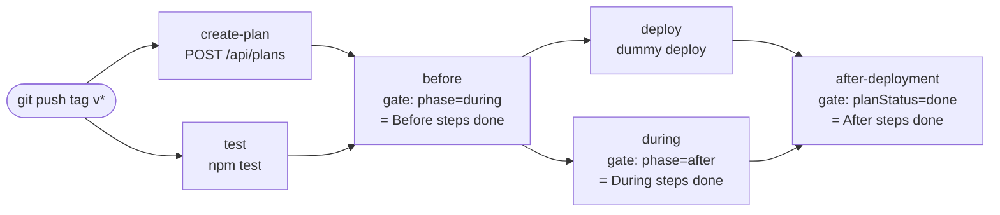

# Deployment Playbook example

A reference GitHub Actions pipeline gated by [Deployment Playbook](https://deployment-playbook.com).
The app is deliberately tiny (a Node.js HTTP server with one `node:test` unit test); the interesting part is
[`.github/workflows/deploy.yml`](.github/workflows/deploy.yml) and two reusable composite actions:
[`create-playbook-plan`](.github/actions/create-playbook-plan/action.yml) and
[`wait-for-playbook`](.github/actions/wait-for-playbook/action.yml).

Full documentation: [deployment-playbook.com/docs](https://deployment-playbook.com/docs) (GitLab CI and Azure DevOps
versions of this pipeline are in the [recipes](https://deployment-playbook.com/docs/recipes)).

Pushing a release tag (`v*`) creates a Deployment Playbook plan from your template automatically; the pipeline then
waits for the approvals of each phase.

## Flow



1. **test** – runs `npm test`. In parallel, **create-plan** calls `POST /api/plans` with the template from
   `PLAYBOOK_TEMPLATE_ID`, `ref` = the tag name, the commit SHA, repository and a link to the run. The plan URL is written
   to the job summary. Re-running the workflow for the same tag reuses the same plan (idempotent per repository + ref).
   On a manual run you can pass `plan_id` to gate on an existing plan instead.
2. **before** – waits until every *Before deployment* step is approved or skipped (`?phase=during` returns
   `allow: true`). Nothing is deployed before that.
3. **deploy** and **during** run in parallel. `deploy` is a placeholder (`echo`); `during` waits until every
   *During deployment* step is approved or skipped (`?phase=after` returns `allow: true`).
4. **after-deployment** (needs `deploy` and `during`) waits until the **whole plan is complete**: `?phase=after`
   returns `allow: true` **and** `planStatus` is `done`. The run only turns green once the *After deployment* steps are
   approved/skipped in Deployment Playbook.

### Why each job asks for the *next* phase

The gate answers "may work in this phase **start**?": `?phase=after` becomes `allow: true` as soon as all *Before* and
*During* steps are resolved, before any *After* step is done. Deployment Playbook marks a plan `DONE` (reported as
`planStatus: "done"`) the moment its last step is approved or skipped, so the final job polls `?phase=after` and
additionally requires `planStatus == "done"` (`require-done: "true"` on the action). The same logic is why the
`before` job polls `?phase=during` (Before complete) and the `during` job polls `?phase=after` (During complete):
`?phase=before` would be allowed immediately, before anything is approved.

### Polling behaviour

- `curl` every 15 s with `Authorization: Bearer <token>` (plus `x-vercel-protection-bypass` only when that secret is set).
- Each poll prints `allow`, `planStatus`, `reason` and `planUrl` (parsed with `jq`). The token is masked and never printed.
- **Fails closed**: a non-200 response, network error or invalid JSON counts as "not allowed" and polling continues.
- Fails when the timeout is reached (default 60 min, `timeout_minutes` input on manual runs) or when the plan is rolled back.

## Setup

1. In Deployment Playbook, an **Admin** creates a workspace API token on `/w/<your-workspace>/connections`.
   Plans created with the token are proposed on behalf of that Admin (so with four-eyes on, someone else approves).
2. In this repo (or your copy), **Settings → Secrets and variables → Actions**:
   | Kind | Name | Value |
   | --- | --- | --- |
   | Secret | `PLAYBOOK_API_TOKEN` | the workspace API token |
   | Variable | `PLAYBOOK_URL` | e.g. `https://deployment-playbook.com` |
   | Variable | `PLAYBOOK_TEMPLATE_ID` | template id, copy it from the template page (Templates → your template → *Copy*). Ids stay stable when a template is renamed |
   | Secret (optional) | `VERCEL_AUTOMATION_BYPASS` | only if you self-host Deployment Playbook behind Vercel Deployment Protection |
3. Have a template with steps in the three phases, e.g.
   - **Before deployment**: "Change approved by product owner", "DB backup taken"
   - **During deployment**: "Monitor dashboards during rollout"
   - **After deployment**: "Smoke test production", "Close the change"

## Usage

```bash
git tag v1.0.0 && git push origin v1.0.0
```

Open the plan link from the run summary, approve the plan, then approve the steps phase by phase; the jobs unblock as
you go and the run turns green once the After deployment steps are done.

## Create plan API

```bash
curl -X POST "$PLAYBOOK_URL/api/plans" \
  -H "Authorization: Bearer $PLAYBOOK_API_TOKEN" -H "Content-Type: application/json" \
  -d '{"templateId":"cmabc123template","ref":"v1.0.0","repository":"acme/app","commitSha":"3f2c1ab","runUrl":"https://github.com/acme/app/actions/runs/1"}'
```

Body: `templateId` (required; the older `template` field with an id or exact name still works), optional `name` (default `Release <ref>`), `environment` (default
`production`), `ref`, `repository`, `commitSha`, `runUrl`, `fourEyes`. Response (201 created, 200 when a plan for the
same repository + ref already exists):

```json
{
  "id": "abc123",
  "name": "Release v1.0.0",
  "status": "PROPOSED",
  "planUrl": "https://deployment-playbook.com/w/acme/plans/abc123",
  "gateUrl": "https://deployment-playbook.com/api/gate/abc123",
  "created": true
}
```

Errors return `{"error": "..."}` with 400 (invalid body), 401 (bad token), 403 (not allowed / plan limit), 404 (unknown template).

## Gate API

`GET {PLAYBOOK_URL}/api/gate/{planId}?phase=before|during|after[&step={planStepId}]`
with `Authorization: Bearer <workspace API token>`. Missing `phase` defaults to `during`. A phase is allowed once the plan
is approved (in progress) and all steps of the earlier phases are approved or skipped.

Example response:

```json
{
  "allow": false,
  "reason": "1 step in \"Before deployment\" still open",
  "gatePhase": "DURING",
  "planStatus": "in_progress",
  "currentPhase": "BEFORE",
  "steps": { "approved": 1, "skipped": 0, "total": 5 },
  "planUrl": "https://deployment-playbook.com/w/acme/plans/abc123"
}
```

## Run locally

```bash
npm test
npm start   # http://localhost:3000/?name=you
```

## License

MIT © Generation Y B.V.
